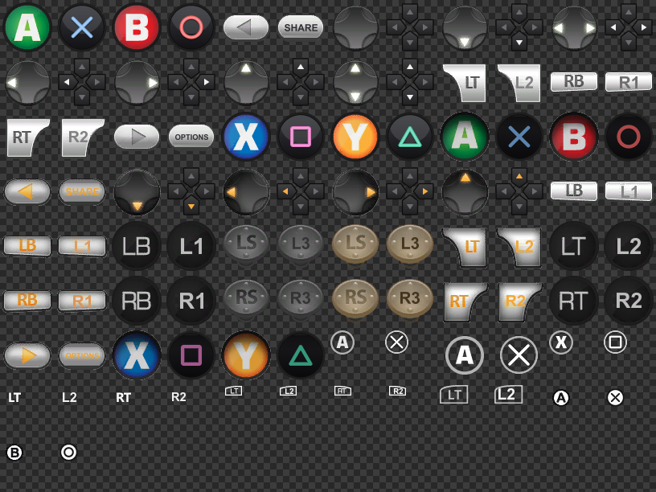

# Deus Ex: Human Revolution DC — DualShock Button Icons

PlayStation (DualShock) button icons for **Deus Ex: Human Revolution —
Director's Cut** (PC). The game only ever shows Xbox 360 prompts; this mod
replaces every one of them:

- **A / B / X / Y** → Cross / Circle / Square / Triangle (dark buttons,
  classic PlayStation glyph colours), including the pressed variants
- **LB / RB / LT / RT** → L1 / R1 / L2 / R2 in all three art styles the
  game uses (silver pills, angular triggers, dark circles), plus the
  text-only labels in the inventory, map and mission log
- **LS / RS** → L3 / R3, **BACK / START** → SHARE / OPTIONS
- **D-pad** redrawn in the split DualShock style
- the **controller layout screen** (Options → Controls) shows the Sony
  DualShock 3 render with its authored PS3 callouts — both were shipped
  unused inside the PC files; the mod flips the platform switch in the
  screen's ActionScript so Windows takes the PS3 path

501 texture instances across 25 archive files are patched: the global
HUD/menu Scaleform databases, the tutorial icon library, and every
in-world interactive screen (keypads, hacking, computers, ebooks,
newspaper kiosks).



## Requirements

- Deus Ex: Human Revolution — **Director's Cut** (GOG or Steam)
- [Gibbed's DXHRDC ModHook](https://github.com/gibbed/DXHRDC-ModHook) —
  replaces `DFEngine.dll` and makes the game load `mods\*.000` archives.
  (If you use the Russian sound localisation mod, it is already
  installed.)
- A pad the game can see as XInput. DualShock/DualSense owners: use
  DS4Windows or Steam Input — the game is XInput-only.

## Install

1. Install the ModHook (link above): back up `DFEngine.dll` in the game
   folder and replace it with the one from the ModHook release.
2. Download `DS4ICONS.000` from
   [Releases](../../releases) and drop it into `<game>\mods\`
   (create the folder if it does not exist).
3. Play.

**Uninstall:** delete `<game>\mods\DS4ICONS.000`. Nothing else is
touched — the original archives are never modified.

## Known issues

- **Game crashes instantly / nothing happens when launching from GOG
  Galaxy while DS4Windows is running.** This is not caused by the mod:
  the Galaxy in-game overlay's injection conflicts with the virtual
  XInput pad on this old engine (crash in `dxgi.dll` at startup, with or
  without the mod). Fix: disable the Galaxy overlay for this game
  (game page → settings → *Disable in-game overlay*), or launch the game
  outside Galaxy.
- The layout screen uses the PS3-era art, so the middle buttons read
  SELECT/START there (prompts elsewhere say SHARE/OPTIONS).
- Prompts appear only while a controller is active; keyboard users see
  the usual key names.
- A game update would disable the ModHook (it deactivates itself
  gracefully) — the game keeps working, just without mods.

## Building from source

The mod archive is built from your own game copy — the repository
contains no game data:

```
set DXHR_GAME_DIR=C:\path\to\Deus Ex HRDC
git clone https://github.com/gibbed/Gibbed.CrystalDynamics work/Gibbed.CrystalDynamics
python tools/scan_all.py    # index every texture in the bigfile (once)
python tools/build_mod.py   # draw the art, patch the DRMs, pack DS4ICONS.000
python tools/verify_mod.py  # re-parse the result and decode samples
```

Plain Python 3, no packages (the Gibbed clone is only used for its
community file-name lists). Text on the labels is rasterised through
ffmpeg (`drawtext`), which must be on PATH, and two fonts are expected as
`tools/font_bold.ttf` / `tools/font_semi.ttf` (any bold sans works;
system fonts are not redistributed here).

`tools/dxhr.py` documents the BigFile V2 / CDRM / DRM v21 / PCD9 formats
(ported from Rick Gibbed's zlib-licensed C# sources —
[Gibbed.CrystalDynamics](https://github.com/gibbed/Gibbed.CrystalDynamics)).
`tools/as2.py` + `tools/swf_template.py` carry the ActionScript patch for
the layout screen. `tools/icons.py` draws the replacement art: procedural
faces/d-pad, and label surgery that keeps the game's own authored pixels
for the silver hardware buttons.

---

## Установка (RU)

1. Поставить [DXHRDC ModHook](https://github.com/gibbed/DXHRDC-ModHook)
   (подменяет `DFEngine.dll`; если стоит русификатор звука — он уже есть).
2. Скачать `DS4ICONS.000` из [Releases](../../releases) и положить в
   `<игра>\mods\`.
3. Играть с геймпадом через DS4Windows или Steam Input (игра понимает
   только XInput).

**Удаление:** стереть `<игра>\mods\DS4ICONS.000` — оригинальные файлы
игры не изменяются.

**Известная проблема:** запуск из GOG Galaxy при включённом DS4Windows
может мгновенно падать (конфликт оверлея Galaxy с виртуальным геймпадом,
не связан с модом) — отключите внутриигровой оверлей Galaxy для этой
игры или запускайте игру напрямую.
